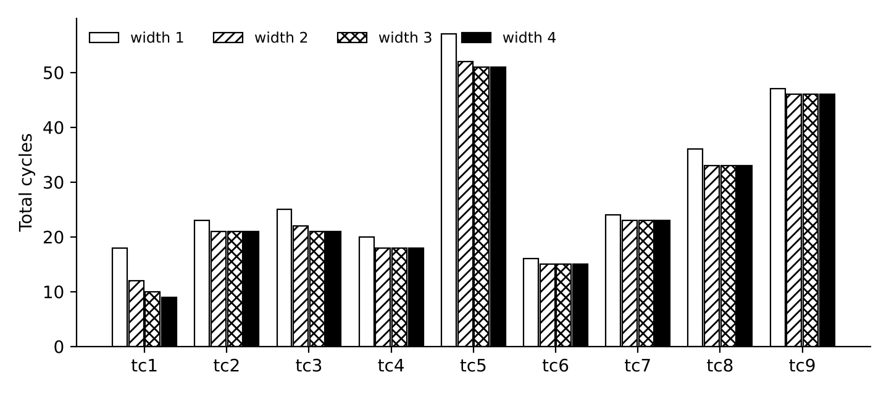

# Programming Assignment: Tomasulo Algorithm with Multiple Issue

**Adding 1–4-wide in-order issue to a Tomasulo simulator with ROB, register renaming, speculative execution and memory disambiguation**

| Item | Details |
|---|---|
| Student | Nagendra |
| GitHub repository (this assignment) | <https://github.com/npkv/Tomasulo> |
| GitHub repository (branch predictor assignment) | <https://github.com/npkv/Branch-Predictor> |

## 1. Introduction

I started from the existing Python Tomasulo simulator, `original_code/` (Qing, 2017;
github.com/qingyangqing/Tomasulo), which supports a single issue per cycle. The work
covered four things:

1. **Multiple issue (1–4 instructions per cycle, in order).** The width comes from the
   input file (`Issue width = N`) or from `--issue-width N`. Write-back (CDB) and commit
   are as wide as issue by default. Each can be set separately, for example
   `CDB width = 1` for a single CDB.
2. **The rest of the specified machine**, which the starting code did not have: input-file
   configuration (number of RS, EX cycles, MEM cycles, number of FUs, ROB size, registers,
   memory), the 8-entry BTB with a 1-bit predictor, speculative execution with misprediction
   recovery, `Beq`, an unpipelined integer adder, and the required output (instruction
   status table, register values, non-zero memory).
3. **Bug fixes in the starting code.** Several bugs became visible, or got worse, once more
   than one instruction is in flight per cycle (Section 2).
4. **Test cases and automatic verification.** Nine test programs run under issue widths
   1–4. Every run is checked against a sequential reference interpreter and against a set
   of timing rules, and a random-program stress test is included (Section 7).

### What works

* Issue width 1, 2, 3 and 4 (in-order issue; issue stops at the first structural hazard).
* Out-of-order execution with register renaming through the RAT/ROB, and in-order commit.
* Multiple functional units of each kind. The integer adder is unpipelined; the FP adder and
  FP multiplier are pipelined.
* Load/store queue with a dedicated address adder, store-to-load forwarding (1 cycle),
  conservative memory disambiguation, stores writing memory at commit, and a single-ported
  non-pipelined memory.
* Branch prediction with the 8-entry BTB and 1-bit predictor, prediction at ISSUE,
  resolution at the end of EX, squash plus RAT recovery, and correct fetch at n+2.
* All 36 test runs (9 tests × 4 widths) and 1,600 random runs produce the same registers,
  memory and committed instruction stream as the sequential reference.

### Limitations / known differences

* Memory disambiguation is conservative: a load waits until every older store's address is
  known; it never speculates past unknown store addresses.
* As in the original code, memory is an array of 256 byte addresses with one value per
  address, and there is no byte-level overlap between neighbouring words. Programs normally
  use word-aligned addresses; the handout's own sample loads from address 18, which this
  model accepts.
* Values are kept as Python floats (double precision) rather than rounded to single
  precision.
* By default the CDB and commit widths equal the issue width (as in the sample report).
  Set `CDB width = 1` / `Commit width = 1` for a single CDB; Section 6.4 shows the effect.

## 2. Problems found in the starting code

| # | Original behaviour | Effect | Fix |
|---|---|---|---|
| 1 | `mem.py`: `if (check_if_sd_committable):` names the function but never calls it (always true), and the function reads a non-existent field `ldsd_tag` | stores could write memory **before** they commit, so a squashed store would corrupt memory | stores write memory only in COMMIT (`commit.py`) |
| 2 | `wb.py`: a broadcast writes the value into the RAT for the destination register unconditionally | if a younger instruction has already renamed the same register, the RAT loses that mapping and later readers get a stale value (a WAW bug that happens much more often with multiple issue) | the RAT maps registers to ROB entries only; values are read from the ROB, and commit clears a RAT entry only if it still points at the committing entry |
| 3 | `mem.py`: the load "has no data yet" test examines `ld_sd_queue[0]` instead of the load being scheduled; forwarding only looks at the nearest older store | wrong loads selected, missed forwarding | per-load checks; youngest older matching store |
| 4 | `issue.py`: after a `Bne` fetch stops until it resolves; no prediction; no `Beq`; branch offset in bytes | no speculation | BTB + 1-bit predictor, speculative issue, squash/recovery, `Beq`, word offsets as in the ISA (`PC+4+offset<<2`) |
| 5 | `main.py`: every parameter hard-coded; the input file holds only instructions | cannot run the required inputs | full input-file parser (`config.py`) |
| 6 | `exe.py`: the integer adder is pipelined, one unit per kind, and the FU entry can be advanced twice in one cycle (the sample report needed a workaround) | wrong timing | explicit start/end cycles per operation; pipelined and unpipelined unit pools with "# of FUs" units |
| 7 | records are built from a new `namedtuple` *class* per entry, with fields stored as class attributes | fragile shared state | plain classes with `__slots__` (`init.py`) |
| 8 | registers and memory are never printed | output incomplete | `print_status.py` prints the required output |

## 3. Code changes

The module structure of the original is kept. Every original file has a header comment
describing what it did and what was changed. New files are marked "(new)".

| File | Role | Changes |
|---|---|---|
| `main.py` | cycle loop, command line | Reads the input file. Options: `--issue-width`, `--cdb-width`, `--commit-width`, `--show-squashed`, `--verbose`, `--max-cycles`. Stage order per cycle: COMMIT → WB → MEM → EX → ISSUE → branch resolution. |
| `config.py` (new) | input parser | Case-insensitive; FU table, `ROB entries`, `Issue width`, optional `CDB width` / `Commit width`, register and memory initial values, instructions with or without commas. |
| `init.py` | data structures | `Machine`, `ROBEntry` (with branch fields), `RSEntry`, `LSQEntry`, `Operand` (value + cycle it became available), `FUPool` (pipelined / unpipelined, N units). |
| `issue.py` | ISSUE | **Multi-issue loop** (below), renaming inside the issue group, BTB prediction, group ends after a predicted-taken branch, fetch stall after a misprediction. |
| `exe.py` | EX | Oldest-first selection; up to "# of FUs" starts per cycle; unpipelined integer adder; branch outcome computed; address calculation on the address adder. |
| `mem.py` | MEM (loads) | Disambiguation, forwarding from queued stores and from committed stores still writing memory, single memory port. |
| `wb.py` | WB / CDB | Up to `cdb_width` broadcasts per cycle, oldest first; no RAT write (bug 2). |
| `commit.py` | COMMIT | Up to `commit_width` in order; stores write memory here; RAT entry cleared only if still mapped to the entry. |
| `branch.py` (new) | BTB | 8 entries, index = word address mod 8, tag = full word address, target, 1-bit prediction. |
| `squash.py` (new) | recovery | Updates the BTB; on a misprediction removes younger ROB/RS/LSQ/FU/CDB entries, rebuilds the RAT, redirects fetch to cycle n+2. |
| `print_status.py` | output | Instruction status table, register values, non-zero memory, summary; optionally the squashed instructions. |
| `reference.py` (new) | testing | Sequential ISA interpreter used by the checker. |

The core multi-issue change in `issue.py`:

```python
# Original: exactly one instruction per call
def issue(cycle, PC, instructions, ROB, size_ROB, rs_int_adder, ...):
    ins = instructions[PC.PC]
    ...

# Now: up to issue_width instructions per cycle, strictly in order
def issue(m, cycle):
    if cycle < m.fetch_resume:                  # misprediction: fetch restarts at n+2
        return
    issued = 0
    while issued < m.cfg.issue_width and 0 <= m.pc < len(m.program):
        ins = m.program[m.pc]
        rob = issue_one(m, ins, cycle)          # ROB + RS/LSQ + renaming
        if rob is None:                         # ROB / RS / LSQ full: stop, stay in order
            break
        issued += 1
        if ins.op in ('Beq', 'Bne'):
            taken, target = m.btb.predict(m.pc) # 1-bit predictor + BTB at ISSUE
            rob.pred_taken, rob.pred_target = taken, target
            m.pc = target
            if taken:                           # redirect: rest of the group is dropped
                break
        else:
            m.pc += 1
```

Because each instruction in a group reads the RAT after the earlier ones have renamed their
destinations, dependences *inside* a group are renamed correctly. For example, in
`Add.d F3,…` followed by `Mult.d F4, F3, F3` in the same cycle, the multiply waits on the
add's ROB tag.

`wb.py` and `commit.py` have the same shape: a loop of up to `cdb_width` (or `commit_width`)
iterations over the oldest eligible entries.

## 4. Timing model

| Rule | Value |
|---|---|
| ISSUE | up to *W* per cycle, in order; stops at the first instruction without a ROB entry, RS or LSQ slot |
| EX start | ≥ issue + 1, and ≥ (cycle the last operand was broadcast) + 1 |
| EX length | "Cycles in EX"; integer adder busy for the whole time (unpipelined); FP units and the address adder accept one new op per unit per cycle |
| RS release | when EX starts (usable by an ISSUE in the same cycle) |
| MEM (load) | ≥ address EX end + 1; waits for older unknown store addresses; forwarding takes 1 cycle; memory access takes "Cycles in Mem" on the single port |
| WB | ≥ end of EX (or MEM for loads) + 1; up to the CDB width per cycle, oldest first |
| COMMIT | ≥ WB + 1 (branches: ≥ EX end + 1); in order; up to the commit width |
| Store | commits when address and data are known and the memory port is free; writes memory during commit for "Cycles in Mem" cycles (MEM column) |
| Branch | predicted at ISSUE; resolved at the end of its last EX cycle *n*; recovery in *n*+1; correct fetch in *n*+2 |
| Predicted-taken branch | ends the issue group; fetch continues at the target in the next cycle |

## 5. Input and output

Input is the format from the handout. Case is ignored, commas are optional, and lines
starting with `#` are comments. `CDB width` and `Commit width` are optional additions.

```
                   # of rs   Cycles in EX   Cycles in Mem   # of FUs
Integer adder         2           1                            1
FP adder              3           3                            1
FP multiplier         2          20                            1
Load/store unit       3           1             4              1

ROB entries = 128
Issue width = 2
R1=10, R2=20, F2=30.1
Mem[4]=1, Mem[8]=2, Mem[12]=3.4

Add.d F1, F2, F3
Ld F4, 8(R1)
Bne R2, R3, -3
```

The output is the instruction status table, one row per committed dynamic instruction with
the cycle of every stage, followed by `REGISTER VALUES` (R0–R31, F0–F31) and
`NON-ZERO MEMORY VALUES`. EX/MEM ranges are printed as `first-last`. Stores show their
memory write in the MEM column; stores and branches have no WB. With `--show-squashed`, the
wrong-path instructions are listed separately.

```
python3 code/main.py tests/tc5_loop.txt --issue-width 2 --show-squashed
./run_tests.sh        # all tests x widths 1-4 -> results/, then tests/check.py
```

## 6. Test cases and results under different issue widths

| Test | What it exercises |
|---|---|
| tc1_independent | 12 independent instructions with enough units: throughput should grow with width |
| tc2_renaming | RAW, WAR and WAW on F3 and R1 (also inside one issue group); writes to R0 |
| tc3_structural | ROB of 4 entries, 1 RS per unit, 1 LSQ entry: issue stalls stay in order |
| tc4_memory | store→load forwarding with late store data; load bypassing a non-matching store; load waiting for an unknown store address |
| tc5_loop | the original simulator's loop (3 iterations): loop-carried values, BTB prediction, mispredictions at the first iteration and at the exit |
| tc6_mispredict | two taken branches that miss in the BTB; wrong-path ALU ops and a wrong-path **store** must be squashed |
| tc7_btb_alias | two branches mapping to the same BTB entry (word 1 and word 9) keep evicting each other |
| tc8 / tc9 | test cases #01 and #02 of the sample report (same configuration and program) |
| spec_sample | the handout's sample input (never terminates: R3 is never written, so `Bne R2, R3` is always taken); run for 40 cycles |

### 6.1 Summary (default: CDB width = commit width = issue width)

| Test | Instr. | Cycles w1 | w2 | w3 | w4 | IPC w1 | IPC w4 | Speed-up w4/w1 | Mispredicted | Squashed w1 / w2 / w3 / w4 |
|---|---:|---:|---:|---:|---:|---:|---:|---:|---:|---|
| tc1_independent | 12 | 18 | 12 | 10 | 9 | 0.667 | 1.333 | 2.00× | 0 | 0 / 0 / 0 / 0 |
| tc2_renaming | 10 | 23 | 21 | 21 | 21 | 0.435 | 0.476 | 1.10× | 0 | 0 / 0 / 0 / 0 |
| tc3_structural | 10 | 25 | 22 | 21 | 21 | 0.400 | 0.476 | 1.19× | 0 | 0 / 0 / 0 / 0 |
| tc4_memory | 10 | 20 | 18 | 18 | 18 | 0.500 | 0.556 | 1.11× | 0 | 0 / 0 / 0 / 0 |
| tc5_loop | 25 | 57 | 52 | 51 | 51 | 0.439 | 0.490 | 1.12× | 2 | 1 / 1 / 1 / 1 |
| tc6_mispredict | 6 | 16 | 15 | 15 | 15 | 0.375 | 0.400 | 1.07× | 2 | 3 / 5 / 7 / 9 |
| tc7_btb_alias | 10 | 24 | 23 | 23 | 23 | 0.417 | 0.435 | 1.04× | 5 | 5 / 14 / 20 / 20 |
| tc8_sample_report_1 | 17 | 36 | 33 | 33 | 33 | 0.472 | 0.515 | 1.09× | 0 | 0 / 0 / 0 / 0 |
| tc9_sample_report_2 | 17 | 47 | 46 | 46 | 46 | 0.362 | 0.370 | 1.02× | 0 | 0 / 0 / 0 / 0 |



**Discussion.**

* **tc1 (independent work)** shows the clearest effect of the wider front end: 18 → 12 →
  10 → 9 cycles (IPC 0.67 → 1.33). The gain beyond width 2 shrinks because only two integer
  adders, two FP adders, two multipliers and one memory port exist. In-order commit also
  waits for the 4-cycle multiplies.
* **True dependences limit the others.** tc2 is a dependence chain through a 6-cycle
  multiply, so widths 2–4 all finish in 21 cycles. tc5 and tc8/tc9 are dominated by the
  15/20-cycle multiplies and the single non-pipelined memory port, so wider issue only
  fills the window sooner (tc5: 57 → 51; tc8: 36 → 33).
* **Structural hazards (tc3).** With a 4-entry ROB and 1 RS per unit, issue stalls at the
  first full resource and stays in order. Width 4 gains only 4 cycles over width 1.
* **Speculation (tc6, tc7).** Results are correct at every width. Wider issue puts **more
  wrong-path instructions** into the machine before a branch resolves (tc6: 3, 5, 7, 9
  squashed for widths 1–4; tc7: 5, 14, 20, 20), and all of them are discarded. In tc7 the
  aliasing branches are mispredicted every time, so the n+2 refetch penalty dominates and
  width barely matters.

### 6.2 Example: tc1 with width 1 and width 4

**Width 1**

```
                          ISSUE   EX        MEM       WB    COMMIT
Add R3, R1, R2            1       2                   3     4
Add.d F4, F1, F2          2       3-4                 5     6
Mult.d F5, F2, F3         3       4-7                 8     9
Addi R4, R1, 5            4       5                   6     10
Sub.d F6, F3, F1          5       6-7                 9     11
Ld F7, 0(R0)              6       7         8-9       10    12
Sub R5, R2, R1            7       8                   11    13
Add.d F8, F3, F3          8       9-10                12    14
Mult.d F9, F1, F1         9       10-13               14    15
Addi R6, R2, 7            10      11                  13    16
Add R7, R1, R1            11      12                  15    17
Sub.d F10, F2, F1         12      13-14               16    18
```
Registers (non-zero): R1=1, R2=2, R3=3, R4=6, R5=1, R6=9, R7=2, F1=1.0, F2=2.0, F3=3.0, F4=3.0, F5=6.0, F6=2.0, F7=4.0, F8=6.0, F9=1.0, F10=1.0  
Memory (non-zero): Mem[0]=4.0  
12 instructions, 18 cycles, IPC 0.667, mispredicted branches 0, squashed 0.

**Width 4**

```
                          ISSUE   EX        MEM       WB    COMMIT
Add R3, R1, R2            1       2                   3     4
Add.d F4, F1, F2          1       2-3                 4     5
Mult.d F5, F2, F3         1       2-5                 6     7
Addi R4, R1, 5            1       2                   3     7
Sub.d F6, F3, F1          2       3-4                 5     7
Ld F7, 0(R0)              2       3         4-5       6     7
Sub R5, R2, R1            2       3                   4     8
Add.d F8, F3, F3          2       3-4                 5     8
Mult.d F9, F1, F1         3       4-7                 8     9
Addi R6, R2, 7            3       4                   5     9
Add R7, R1, R1            3       4                   5     9
Sub.d F10, F2, F1         3       4-5                 6     9
```
Registers (non-zero): R1=1, R2=2, R3=3, R4=6, R5=1, R6=9, R7=2, F1=1.0, F2=2.0, F3=3.0, F4=3.0, F5=6.0, F6=2.0, F7=4.0, F8=6.0, F9=1.0, F10=1.0  
Memory (non-zero): Mem[0]=4.0  
12 instructions, 9 cycles, IPC 1.333, mispredicted branches 0, squashed 0.


At width 4, the first four instructions issue together in cycle 1 and start executing in
cycle 2 on different units. Four instructions also commit together (cycle 7, after the
multiply's WB in cycle 6).

### 6.3 Example: misprediction recovery (tc6, width 2)

```
                          ISSUE   EX        MEM       WB    COMMIT
Beq R1, R2, 3             1       2                         3
Ld F2, 0(R0)              4       5         6-7       8     9
Add.d F3, F2, F1          4       9-10                11    12
Sub R4, R3, R1            5       6                   7     12
Bne R4, R0, 1             5       8                         13
Sub.d F5, F3, F1          10      12-13               14    15

SQUASHED (wrong-path) INSTRUCTIONS
                          ISSUE   EX        MEM       WB    COMMIT
Addi R3, R3, 100          1
Sd F1, 0(R0)              2
Add.d F1, F1, F1          2
Mult.d F3, F3, F3         6
Sub.d F5, F3, F1          6
```
Registers (non-zero): R1=1, R2=1, R3=5, R4=4, F1=2.0, F2=7.0, F3=9.0, F5=7.0  
Memory (non-zero): Mem[0]=7.0  
6 instructions, 15 cycles, IPC 0.400, mispredicted branches 2, squashed 5.


`Beq R1, R2, 3` misses in the BTB, so it is predicted not taken and the wrong-path
`Addi R3`, `Sd F1` and `Add.d F1` are issued in cycles 1–2. The branch resolves (taken) at
the end of its EX in cycle 2; recovery happens in cycle 3, and the correct instruction
`Ld F2` is issued in cycle **4** = n+2. The same happens for `Bne` (resolved in cycle 8,
refetch in cycle 10). The wrong-path store never reaches memory: Mem[0] keeps 7.0, and R3 =
5, F1 = 2.0, F3 = 9.0 are the architecturally correct values.

### 6.4 Effect of a single CDB

With `--cdb-width 1 --commit-width 1` (one CDB, one commit per cycle), tc1 needs 18 / 17 / 16
/ 16 cycles for widths 1–4, against 18 / 12 / 10 / 9 with matching widths. A single CDB
serialises write-back: in the width-4 run, results finish EX in cycles 2–5 but are broadcast
one per cycle in cycles 3–14. A wider issue stage therefore needs a matching number of
result buses and commit ports to pay off. tc5 gives 57 / 55 / 55 / 55, and tc8 stays at 36
at every width.

### 6.5 Comparison with the sample report

tc8 and tc9 use the sample report's configurations and programs. Total cycles equal the
sample report's for widths 1 and 2 (tc8: 36 and 33; tc9: 47 and 46).

* **tc8, width 2:** the instruction status table is identical to the sample report's
  Figure 2, row for row.
* **tc8, width 1:** one difference. When two results are ready in the same cycle, this
  simulator broadcasts the older instruction first (`Mult.d F2, F1, F1` in cycle 16, then
  the second `Ld F1` in cycle 17). The sample report used completion order, so it has the
  reverse.
* **tc9:** a few rows differ. In the sample, the second load's memory access (7–11)
  overlaps the first load's (3–7) on the single memory port, and `Addi R1, R1, 8` starts EX
  in cycle 9, the same cycle its operand is broadcast. This simulator serialises the memory
  port (second load at 8–12) and starts dependants in the cycle after the broadcast (EX in
  cycle 10). The end-to-end time is the same either way, because the multiplies dominate.

The sample report's version could not run branches at widths above 1; this simulator runs
them at every width (tc5–tc7).

## 7. Verification

**`tests/check.py`** runs every test at widths 1–4 and checks:

* **Functional:** the committed instruction sequence, final registers and final memory are
  identical to a plain sequential interpreter of the same ISA (`code/reference.py`).
* **Timing / structural:** issue in order and ≤ *W* per cycle (wrong-path instructions
  included); commit in order and ≤ commit width; EX after ISSUE with exactly the
  configured length; WB after EX/MEM; COMMIT after WB; no instruction starts EX before
  each producer's WB (RAW); ≤ CDB width broadcasts per cycle; the memory port is never used
  twice in one cycle; the unpipelined integer adder count is never exceeded and pipelined
  units start ≤ "# of FUs" ops per cycle; after a misprediction resolved in cycle *n*, the
  next instruction issues no earlier than *n*+2; forwarded loads always have an older store
  to the same address in flight.

**`tests/fuzz.py`** generates random programs (all ALU ops, loads and stores to overlapping
addresses, forward branches, a counted loop) on random configurations (ROB 2–32 entries,
1–5 RS, 1–2 units, random latencies) and applies the same checks at all four widths. With
400 programs × 4 widths, about 22,000 committed instructions, 1,700 mispredictions,
4,000 squashed instructions and 280 forwarded loads, every check passed.

```
$ python3 tests/check.py      ->  ALL CHECKS PASSED   (36 runs)
$ python3 tests/fuzz.py 400   ->  400 random programs x 4 issue widths: all passed
```

During development the checks found a real issue. A store that committed in the same cycle
a load wanted to forward from it had already left the queue, so the load waited for the
store's memory write instead. In tc4 this made width 4 slower than width 1 (28 vs 20
cycles). Committed stores now stay visible for forwarding until their write completes (a
small write buffer), and tc4 takes 18 cycles at width 4.

## 8. How to run

```
python3 code/main.py <input file> [--issue-width N] [--cdb-width N] [--commit-width N]
                                  [--show-squashed] [--verbose] [--max-cycles N]
./run_tests.sh                    # all tests, widths 1-4, outputs in results/
python3 tests/check.py            # verification
python3 tests/fuzz.py 400         # random stress test
```

Python 3.8 or newer, standard library only. `--verbose` prints a cycle-by-cycle event log
(issue, EX start, MEM, WB, commit, prediction, squash).

## Appendix: instruction status tables for every test and issue width

Full outputs, including all register values, are in `results/<test>_w<width>.txt`.
Configuration lines are omitted here; registers and memory list non-zero values only.

### tc1_independent

Test 1: independent instructions - issue width should scale throughput. Enough reservation stations / units so that the front end is the limit.

**Issue width 1**

```
                          ISSUE   EX        MEM       WB    COMMIT
Add R3, R1, R2            1       2                   3     4
Add.d F4, F1, F2          2       3-4                 5     6
Mult.d F5, F2, F3         3       4-7                 8     9
Addi R4, R1, 5            4       5                   6     10
Sub.d F6, F3, F1          5       6-7                 9     11
Ld F7, 0(R0)              6       7         8-9       10    12
Sub R5, R2, R1            7       8                   11    13
Add.d F8, F3, F3          8       9-10                12    14
Mult.d F9, F1, F1         9       10-13               14    15
Addi R6, R2, 7            10      11                  13    16
Add R7, R1, R1            11      12                  15    17
Sub.d F10, F2, F1         12      13-14               16    18
```
Registers (non-zero): R1=1, R2=2, R3=3, R4=6, R5=1, R6=9, R7=2, F1=1.0, F2=2.0, F3=3.0, F4=3.0, F5=6.0, F6=2.0, F7=4.0, F8=6.0, F9=1.0, F10=1.0  
Memory (non-zero): Mem[0]=4.0  
12 instructions, 18 cycles, IPC 0.667, mispredicted branches 0, squashed 0.

**Issue width 2**

```
                          ISSUE   EX        MEM       WB    COMMIT
Add R3, R1, R2            1       2                   3     4
Add.d F4, F1, F2          1       2-3                 4     5
Mult.d F5, F2, F3         2       3-6                 7     8
Addi R4, R1, 5            2       3                   4     8
Sub.d F6, F3, F1          3       4-5                 6     9
Ld F7, 0(R0)              3       4         5-6       7     9
Sub R5, R2, R1            4       5                   6     10
Add.d F8, F3, F3          4       5-6                 8     10
Mult.d F9, F1, F1         5       6-9                 10    11
Addi R6, R2, 7            5       6                   8     11
Add R7, R1, R1            6       7                   9     12
Sub.d F10, F2, F1         6       7-8                 9     12
```
Registers (non-zero): R1=1, R2=2, R3=3, R4=6, R5=1, R6=9, R7=2, F1=1.0, F2=2.0, F3=3.0, F4=3.0, F5=6.0, F6=2.0, F7=4.0, F8=6.0, F9=1.0, F10=1.0  
Memory (non-zero): Mem[0]=4.0  
12 instructions, 12 cycles, IPC 1.000, mispredicted branches 0, squashed 0.

**Issue width 3**

```
                          ISSUE   EX        MEM       WB    COMMIT
Add R3, R1, R2            1       2                   3     4
Add.d F4, F1, F2          1       2-3                 4     5
Mult.d F5, F2, F3         1       2-5                 6     7
Addi R4, R1, 5            2       3                   4     7
Sub.d F6, F3, F1          2       3-4                 5     7
Ld F7, 0(R0)              2       3         4-5       6     8
Sub R5, R2, R1            3       4                   5     8
Add.d F8, F3, F3          3       4-5                 6     8
Mult.d F9, F1, F1         3       4-7                 8     9
Addi R6, R2, 7            4       5                   7     9
Add R7, R1, R1            4       5                   7     9
Sub.d F10, F2, F1         4       5-6                 7     10
```
Registers (non-zero): R1=1, R2=2, R3=3, R4=6, R5=1, R6=9, R7=2, F1=1.0, F2=2.0, F3=3.0, F4=3.0, F5=6.0, F6=2.0, F7=4.0, F8=6.0, F9=1.0, F10=1.0  
Memory (non-zero): Mem[0]=4.0  
12 instructions, 10 cycles, IPC 1.200, mispredicted branches 0, squashed 0.

**Issue width 4**

```
                          ISSUE   EX        MEM       WB    COMMIT
Add R3, R1, R2            1       2                   3     4
Add.d F4, F1, F2          1       2-3                 4     5
Mult.d F5, F2, F3         1       2-5                 6     7
Addi R4, R1, 5            1       2                   3     7
Sub.d F6, F3, F1          2       3-4                 5     7
Ld F7, 0(R0)              2       3         4-5       6     7
Sub R5, R2, R1            2       3                   4     8
Add.d F8, F3, F3          2       3-4                 5     8
Mult.d F9, F1, F1         3       4-7                 8     9
Addi R6, R2, 7            3       4                   5     9
Add R7, R1, R1            3       4                   5     9
Sub.d F10, F2, F1         3       4-5                 6     9
```
Registers (non-zero): R1=1, R2=2, R3=3, R4=6, R5=1, R6=9, R7=2, F1=1.0, F2=2.0, F3=3.0, F4=3.0, F5=6.0, F6=2.0, F7=4.0, F8=6.0, F9=1.0, F10=1.0  
Memory (non-zero): Mem[0]=4.0  
12 instructions, 9 cycles, IPC 1.333, mispredicted branches 0, squashed 0.

### tc2_renaming

Test 2: RAW / WAR / WAW hazards and register renaming inside one issue group, plus writes to R0 (hard-wired zero).

**Issue width 1**

```
                          ISSUE   EX        MEM       WB    COMMIT
Add.d F3, F1, F2          1       2-4                 5     6
Mult.d F4, F3, F3         2       6-11                12    13
Add.d F3, F1, F1          3       4-6                 7     14
Sub.d F5, F4, F3          4       13-15               16    17
Addi R1, R0, 10           5       6                   8     18
Addi R1, R1, 5            6       9                   10    19
Add R0, R1, R1            7       11                  13    20
Add R2, R1, R0            8       12                  14    21
Sub R3, R2, R1            9       15                  17    22
Add.d F1, F5, F3          10      17-19               20    23
```
Registers (non-zero): R1=15, R2=15, F1=9.0, F2=2.0, F3=2.0, F4=9.0, F5=7.0  
Memory (non-zero): none  
10 instructions, 23 cycles, IPC 0.435, mispredicted branches 0, squashed 0.

**Issue width 2**

```
                          ISSUE   EX        MEM       WB    COMMIT
Add.d F3, F1, F2          1       2-4                 5     6
Mult.d F4, F3, F3         1       6-11                12    13
Add.d F3, F1, F1          2       3-5                 6     13
Sub.d F5, F4, F3          2       13-15               16    17
Addi R1, R0, 10           3       4                   5     17
Addi R1, R1, 5            3       6                   7     18
Add R0, R1, R1            4       8                   9     18
Add R2, R1, R0            4       9                   10    19
Sub R3, R2, R1            5       11                  12    19
Add.d F1, F5, F3          5       17-19               20    21
```
Registers (non-zero): R1=15, R2=15, F1=9.0, F2=2.0, F3=2.0, F4=9.0, F5=7.0  
Memory (non-zero): none  
10 instructions, 21 cycles, IPC 0.476, mispredicted branches 0, squashed 0.

**Issue width 3**

```
                          ISSUE   EX        MEM       WB    COMMIT
Add.d F3, F1, F2          1       2-4                 5     6
Mult.d F4, F3, F3         1       6-11                12    13
Add.d F3, F1, F1          1       3-5                 6     13
Sub.d F5, F4, F3          2       13-15               16    17
Addi R1, R0, 10           2       3                   4     17
Addi R1, R1, 5            2       5                   6     17
Add R0, R1, R1            3       7                   8     18
Add R2, R1, R0            3       8                   9     18
Sub R3, R2, R1            3       10                  11    18
Add.d F1, F5, F3          4       17-19               20    21
```
Registers (non-zero): R1=15, R2=15, F1=9.0, F2=2.0, F3=2.0, F4=9.0, F5=7.0  
Memory (non-zero): none  
10 instructions, 21 cycles, IPC 0.476, mispredicted branches 0, squashed 0.

**Issue width 4**

```
                          ISSUE   EX        MEM       WB    COMMIT
Add.d F3, F1, F2          1       2-4                 5     6
Mult.d F4, F3, F3         1       6-11                12    13
Add.d F3, F1, F1          1       3-5                 6     13
Sub.d F5, F4, F3          1       13-15               16    17
Addi R1, R0, 10           2       3                   4     17
Addi R1, R1, 5            2       5                   6     17
Add R0, R1, R1            2       7                   8     17
Add R2, R1, R0            2       8                   9     18
Sub R3, R2, R1            3       10                  11    18
Add.d F1, F5, F3          3       17-19               20    21
```
Registers (non-zero): R1=15, R2=15, F1=9.0, F2=2.0, F3=2.0, F4=9.0, F5=7.0  
Memory (non-zero): none  
10 instructions, 21 cycles, IPC 0.476, mispredicted branches 0, squashed 0.

### tc3_structural

Test 3: structural hazards - tiny ROB and one reservation station per unit. Wider issue cannot help much: the ROB / RS fill up and issue stalls (in order).

**Issue width 1**

```
                          ISSUE   EX        MEM       WB    COMMIT
Mult.d F3, F1, F2         1       2-7                 8     9
Add.d F4, F3, F1          2       9-10                11    12
Ld F5, 0(R1)              3       4         5-7       9     13
Mult.d F6, F5, F2         4       10-15               16    17
Addi R2, R1, 4            9       10                  12    18
Add.d F7, F6, F4          12      17-18               19    20
Sd F7, 4(R1)              13      14        21-23           21
Addi R3, R2, 4            17      18                  20    22
Sub.d F8, F7, F1          18      20-21               22    23
Ld F9, 8(R0)              21      22        23        24    25
```
Registers (non-zero): R1=4, R2=8, R3=12, F1=1.5, F2=2.0, F3=3.0, F4=4.5, F5=8.0, F6=16.0, F7=20.5, F8=19.0, F9=20.5  
Memory (non-zero): Mem[4]=8.0, Mem[8]=20.5  
10 instructions, 25 cycles, IPC 0.400, mispredicted branches 0, squashed 0.

**Issue width 2**

```
                          ISSUE   EX        MEM       WB    COMMIT
Mult.d F3, F1, F2         1       2-7                 8     9
Add.d F4, F3, F1          1       9-10                11    12
Ld F5, 0(R1)              2       3         4-6       7     12
Mult.d F6, F5, F2         2       8-13                14    15
Addi R2, R1, 4            9       10                  11    15
Add.d F7, F6, F4          12      15-16               17    18
Sd F7, 4(R1)              12      13        18-20           18
Addi R3, R2, 4            15      16                  17    19
Sub.d F8, F7, F1          15      18-19               20    21
Ld F9, 8(R0)              18      19        20        21    22
```
Registers (non-zero): R1=4, R2=8, R3=12, F1=1.5, F2=2.0, F3=3.0, F4=4.5, F5=8.0, F6=16.0, F7=20.5, F8=19.0, F9=20.5  
Memory (non-zero): Mem[4]=8.0, Mem[8]=20.5  
10 instructions, 22 cycles, IPC 0.455, mispredicted branches 0, squashed 0.

**Issue width 3**

```
                          ISSUE   EX        MEM       WB    COMMIT
Mult.d F3, F1, F2         1       2-7                 8     9
Add.d F4, F3, F1          1       9-10                11    12
Ld F5, 0(R1)              1       2         3-5       6     12
Mult.d F6, F5, F2         2       7-12                13    14
Addi R2, R1, 4            9       10                  11    14
Add.d F7, F6, F4          12      14-15               16    17
Sd F7, 4(R1)              12      13        17-19           17
Addi R3, R2, 4            14      15                  16    17
Sub.d F8, F7, F1          14      17-18               19    20
Ld F9, 8(R0)              17      18        19        20    21
```
Registers (non-zero): R1=4, R2=8, R3=12, F1=1.5, F2=2.0, F3=3.0, F4=4.5, F5=8.0, F6=16.0, F7=20.5, F8=19.0, F9=20.5  
Memory (non-zero): Mem[4]=8.0, Mem[8]=20.5  
10 instructions, 21 cycles, IPC 0.476, mispredicted branches 0, squashed 0.

**Issue width 4**

```
                          ISSUE   EX        MEM       WB    COMMIT
Mult.d F3, F1, F2         1       2-7                 8     9
Add.d F4, F3, F1          1       9-10                11    12
Ld F5, 0(R1)              1       2         3-5       6     12
Mult.d F6, F5, F2         2       7-12                13    14
Addi R2, R1, 4            9       10                  11    14
Add.d F7, F6, F4          12      14-15               16    17
Sd F7, 4(R1)              12      13        17-19           17
Addi R3, R2, 4            14      15                  16    17
Sub.d F8, F7, F1          14      17-18               19    20
Ld F9, 8(R0)              17      18        19        20    21
```
Registers (non-zero): R1=4, R2=8, R3=12, F1=1.5, F2=2.0, F3=3.0, F4=4.5, F5=8.0, F6=16.0, F7=20.5, F8=19.0, F9=20.5  
Memory (non-zero): Mem[4]=8.0, Mem[8]=20.5  
10 instructions, 21 cycles, IPC 0.476, mispredicted branches 0, squashed 0.

### tc4_memory

Test 4: load/store queue - store-to-load forwarding, a load that must wait for an older store's unknown address, a load that bypasses a non-matching store, and store data arriving late on the CDB.

**Issue width 1**

```
                          ISSUE   EX        MEM       WB    COMMIT
Mult.d F4, F1, F2         1       2-9                 10    11
Sd F4, 0(R1)              2       3         12-14           12
Ld F5, 0(R2)              3       4         11        12    13
Ld F6, 8(R1)              4       5         6-8       9     14
Add R4, R3, R1            5       6                   7     15
Sd F2, 0(R4)              6       8         16-18           16
Ld F7, 24(R0)             7       9         10        11    17
Add.d F8, F5, F7          8       13-14               15    18
Sd F8, 4(R1)              9       10        19-21           19
Ld F9, 12(R0)             10      11        16        17    20
```
Registers (non-zero): R1=8, R2=8, R3=16, R4=24, F1=1.5, F2=2.5, F4=3.75, F5=3.75, F6=20.0, F7=2.5, F8=6.25, F9=6.25  
Memory (non-zero): Mem[8]=3.75, Mem[12]=6.25, Mem[16]=20.0, Mem[24]=2.5  
10 instructions, 20 cycles, IPC 0.500, mispredicted branches 0, squashed 0.

**Issue width 2**

```
                          ISSUE   EX        MEM       WB    COMMIT
Mult.d F4, F1, F2         1       2-9                 10    11
Sd F4, 0(R1)              1       2         11-13           11
Ld F5, 0(R2)              2       3         11        12    13
Ld F6, 8(R1)              2       4         5-7       8     13
Add R4, R3, R1            3       4                   5     14
Sd F2, 0(R4)              3       6         14-16           14
Ld F7, 24(R0)             4       5         7         8     15
Add.d F8, F5, F7          4       13-14               15    16
Sd F8, 4(R1)              5       7         17-19           17
Ld F9, 12(R0)             8       9         16        17    18
```
Registers (non-zero): R1=8, R2=8, R3=16, R4=24, F1=1.5, F2=2.5, F4=3.75, F5=3.75, F6=20.0, F7=2.5, F8=6.25, F9=6.25  
Memory (non-zero): Mem[8]=3.75, Mem[12]=6.25, Mem[16]=20.0, Mem[24]=2.5  
10 instructions, 18 cycles, IPC 0.556, mispredicted branches 0, squashed 0.

**Issue width 3**

```
                          ISSUE   EX        MEM       WB    COMMIT
Mult.d F4, F1, F2         1       2-9                 10    11
Sd F4, 0(R1)              1       2         11-13           11
Ld F5, 0(R2)              1       3         11        12    13
Ld F6, 8(R1)              2       4         5-7       8     13
Add R4, R3, R1            2       3                   4     13
Sd F2, 0(R4)              2       5         14-16           14
Ld F7, 24(R0)             3       6         7         8     14
Add.d F8, F5, F7          3       13-14               15    16
Sd F8, 4(R1)              3       7         17-19           17
Ld F9, 12(R0)             8       9         16        17    18
```
Registers (non-zero): R1=8, R2=8, R3=16, R4=24, F1=1.5, F2=2.5, F4=3.75, F5=3.75, F6=20.0, F7=2.5, F8=6.25, F9=6.25  
Memory (non-zero): Mem[8]=3.75, Mem[12]=6.25, Mem[16]=20.0, Mem[24]=2.5  
10 instructions, 18 cycles, IPC 0.556, mispredicted branches 0, squashed 0.

**Issue width 4**

```
                          ISSUE   EX        MEM       WB    COMMIT
Mult.d F4, F1, F2         1       2-9                 10    11
Sd F4, 0(R1)              1       2         11-13           11
Ld F5, 0(R2)              1       3         11        12    13
Ld F6, 8(R1)              1       4         5-7       8     13
Add R4, R3, R1            2       3                   4     13
Sd F2, 0(R4)              2       5         14-16           14
Ld F7, 24(R0)             2       6         7         8     14
Add.d F8, F5, F7          2       13-14               15    16
Sd F8, 4(R1)              3       7         17-19           17
Ld F9, 12(R0)             8       9         16        17    18
```
Registers (non-zero): R1=8, R2=8, R3=16, R4=24, F1=1.5, F2=2.5, F4=3.75, F5=3.75, F6=20.0, F7=2.5, F8=6.25, F9=6.25  
Memory (non-zero): Mem[8]=3.75, Mem[12]=6.25, Mem[16]=20.0, Mem[24]=2.5  
10 instructions, 18 cycles, IPC 0.556, mispredicted branches 0, squashed 0.

### tc5_loop

Test 5: the loop of the original simulator (code.in / test_case.txt), with the branch offset written in words as the handout's ISA specifies (PC + 4 + offset << 2): Bne at word 7 with offset -8 jumps back to word 0. 3 iterations; the BTB predicts the loop branch from the 2nd iteration on and mispredicts at the first iteration and at the loop exit.

**Issue width 1**

```
                          ISSUE   EX        MEM       WB    COMMIT
Ld F2, 0(R1)              1       2         3-7       8     9
Mult.d F4, F2, F20        2       9-23                24    25
Ld F6, 0(R2)              3       4         8-12      13    26
Add.d F6, F4, F6          4       25-28               29    30
Sd F6, 0(R2)              5       6         34-38           34
Addi R1, R1, -4           6       7                   9     35
Addi R2, R2, -4           7       8                   10    36
Bne R1, R0, -8            8       10                        37
Ld F2, 0(R1)              12      13        14-18     19    38
Mult.d F4, F2, F20        13      20-34               35    39
Ld F6, 0(R2)              14      15        19-23     25    40
Add.d F6, F4, F6          15      36-39               40    41
Sd F6, 0(R2)              16      17        42-46           42
Addi R1, R1, -4           17      18                  20    43
Addi R2, R2, -4           18      19                  21    44
Bne R1, R0, -8            19      21                        45
Ld F2, 0(R1)              20      21        24-28     30    46
Mult.d F4, F2, F20        21      31-45               46    47
Ld F6, 0(R2)              22      23        29-33     34    48
Add.d F6, F4, F6          23      47-50               51    52
Sd F6, 0(R2)              24      25        53-57           53
Addi R1, R1, -4           25      26                  27    54
Addi R2, R2, -4           26      27                  28    55
Bne R1, R0, -8            27      28                        56
Add.d F20, F2, F2         30      31-34               36    57

SQUASHED (wrong-path) INSTRUCTIONS
                          ISSUE   EX        MEM       WB    COMMIT
Add.d F20, F2, F2         9       10-13
```
Registers (non-zero): R2=20, F2=3.0, F4=9.0, F6=15.0, F20=6.0  
Memory (non-zero): Mem[4]=3.0, Mem[8]=2.0, Mem[12]=1.0, Mem[24]=15.0, Mem[28]=11.0, Mem[32]=7.0  
25 instructions, 57 cycles, IPC 0.439, mispredicted branches 2, squashed 1.

**Issue width 2**

```
                          ISSUE   EX        MEM       WB    COMMIT
Ld F2, 0(R1)              1       2         3-7       8     9
Mult.d F4, F2, F20        1       9-23                24    25
Ld F6, 0(R2)              2       3         8-12      13    25
Add.d F6, F4, F6          2       25-28               29    30
Sd F6, 0(R2)              3       4         33-37           33
Addi R1, R1, -4           3       4                   5     33
Addi R2, R2, -4           4       5                   6     34
Bne R1, R0, -8            4       6                         34
Ld F2, 0(R1)              8       9         13-17     18    35
Mult.d F4, F2, F20        8       19-33               34    35
Ld F6, 0(R2)              9       10        18-22     23    36
Add.d F6, F4, F6          9       35-38               39    40
Sd F6, 0(R2)              10      11        40-44           40
Addi R1, R1, -4           10      11                  12    41
Addi R2, R2, -4           11      12                  13    41
Bne R1, R0, -8            11      13                        42
Ld F2, 0(R1)              13      14        23-27     28    42
Mult.d F4, F2, F20        13      29-43               44    45
Ld F6, 0(R2)              18      19        28-32     33    45
Add.d F6, F4, F6          18      45-48               49    50
Sd F6, 0(R2)              23      24        50-54           50
Addi R1, R1, -4           23      24                  25    51
Addi R2, R2, -4           24      25                  26    51
Bne R1, R0, -8            24      26                        52
Add.d F20, F2, F2         28      29-32               33    52

SQUASHED (wrong-path) INSTRUCTIONS
                          ISSUE   EX        MEM       WB    COMMIT
Add.d F20, F2, F2         5
```
Registers (non-zero): R2=20, F2=3.0, F4=9.0, F6=15.0, F20=6.0  
Memory (non-zero): Mem[4]=3.0, Mem[8]=2.0, Mem[12]=1.0, Mem[24]=15.0, Mem[28]=11.0, Mem[32]=7.0  
25 instructions, 52 cycles, IPC 0.481, mispredicted branches 2, squashed 1.

**Issue width 3**

```
                          ISSUE   EX        MEM       WB    COMMIT
Ld F2, 0(R1)              1       2         3-7       8     9
Mult.d F4, F2, F20        1       9-23                24    25
Ld F6, 0(R2)              1       3         8-12      13    25
Add.d F6, F4, F6          2       25-28               29    30
Sd F6, 0(R2)              2       4         33-37           33
Addi R1, R1, -4           2       3                   4     33
Addi R2, R2, -4           3       4                   5     33
Bne R1, R0, -8            3       5                         34
Ld F2, 0(R1)              7       8         13-17     18    34
Mult.d F4, F2, F20        7       19-33               34    35
Ld F6, 0(R2)              7       9         18-22     23    35
Add.d F6, F4, F6          8       35-38               39    40
Sd F6, 0(R2)              8       10        40-44           40
Addi R1, R1, -4           8       9                   10    40
Addi R2, R2, -4           9       10                  11    41
Bne R1, R0, -8            9       11                        41
Ld F2, 0(R1)              13      14        23-27     28    41
Mult.d F4, F2, F20        13      29-43               44    45
Ld F6, 0(R2)              18      19        28-32     33    45
Add.d F6, F4, F6          18      45-48               49    50
Sd F6, 0(R2)              23      24        50-54           50
Addi R1, R1, -4           23      24                  25    50
Addi R2, R2, -4           23      25                  26    51
Bne R1, R0, -8            24      26                        51
Add.d F20, F2, F2         28      29-32               33    51

SQUASHED (wrong-path) INSTRUCTIONS
                          ISSUE   EX        MEM       WB    COMMIT
Add.d F20, F2, F2         3
```
Registers (non-zero): R2=20, F2=3.0, F4=9.0, F6=15.0, F20=6.0  
Memory (non-zero): Mem[4]=3.0, Mem[8]=2.0, Mem[12]=1.0, Mem[24]=15.0, Mem[28]=11.0, Mem[32]=7.0  
25 instructions, 51 cycles, IPC 0.490, mispredicted branches 2, squashed 1.

**Issue width 4**

```
                          ISSUE   EX        MEM       WB    COMMIT
Ld F2, 0(R1)              1       2         3-7       8     9
Mult.d F4, F2, F20        1       9-23                24    25
Ld F6, 0(R2)              1       3         8-12      13    25
Add.d F6, F4, F6          1       25-28               29    30
Sd F6, 0(R2)              2       4         33-37           33
Addi R1, R1, -4           2       3                   4     33
Addi R2, R2, -4           2       4                   5     33
Bne R1, R0, -8            2       5                         33
Ld F2, 0(R1)              7       8         13-17     18    34
Mult.d F4, F2, F20        7       19-33               34    35
Ld F6, 0(R2)              7       9         18-22     23    35
Add.d F6, F4, F6          7       35-38               39    40
Sd F6, 0(R2)              8       10        40-44           40
Addi R1, R1, -4           8       9                   10    40
Addi R2, R2, -4           8       10                  11    40
Bne R1, R0, -8            8       11                        41
Ld F2, 0(R1)              13      14        23-27     28    41
Mult.d F4, F2, F20        13      29-43               44    45
Ld F6, 0(R2)              18      19        28-32     33    45
Add.d F6, F4, F6          18      45-48               49    50
Sd F6, 0(R2)              23      24        50-54           50
Addi R1, R1, -4           23      24                  25    50
Addi R2, R2, -4           23      25                  26    50
Bne R1, R0, -8            23      26                        51
Add.d F20, F2, F2         28      29-32               33    51

SQUASHED (wrong-path) INSTRUCTIONS
                          ISSUE   EX        MEM       WB    COMMIT
Add.d F20, F2, F2         3
```
Registers (non-zero): R2=20, F2=3.0, F4=9.0, F6=15.0, F20=6.0  
Memory (non-zero): Mem[4]=3.0, Mem[8]=2.0, Mem[12]=1.0, Mem[24]=15.0, Mem[28]=11.0, Mem[32]=7.0  
25 instructions, 51 cycles, IPC 0.490, mispredicted branches 2, squashed 1.

### tc6_mispredict

Test 6: speculative execution and recovery.  Both branches are taken but miss in the BTB, so they are predicted not taken and the wrong-path instructions (Addi R3, the store, Add.d F1, Mult.d F3) are issued and may execute.  They must be squashed: R3, F1, F3 and Mem[0] must keep the correct values, and fetch restarts two cycles after the branch resolves.

**Issue width 1**

```
                          ISSUE   EX        MEM       WB    COMMIT
Beq R1, R2, 3             1       2                         3
Ld F2, 0(R0)              4       5         6-7       8     9
Add.d F3, F2, F1          5       9-10                11    12
Sub R4, R3, R1            6       7                   9     13
Bne R4, R0, 1             7       10                        14
Sub.d F5, F3, F1          12      13-14               15    16

SQUASHED (wrong-path) INSTRUCTIONS
                          ISSUE   EX        MEM       WB    COMMIT
Addi R3, R3, 100          2
Mult.d F3, F3, F3         8
Sub.d F5, F3, F1          9
```
Registers (non-zero): R1=1, R2=1, R3=5, R4=4, F1=2.0, F2=7.0, F3=9.0, F5=7.0  
Memory (non-zero): Mem[0]=7.0  
6 instructions, 16 cycles, IPC 0.375, mispredicted branches 2, squashed 3.

**Issue width 2**

```
                          ISSUE   EX        MEM       WB    COMMIT
Beq R1, R2, 3             1       2                         3
Ld F2, 0(R0)              4       5         6-7       8     9
Add.d F3, F2, F1          4       9-10                11    12
Sub R4, R3, R1            5       6                   7     12
Bne R4, R0, 1             5       8                         13
Sub.d F5, F3, F1          10      12-13               14    15

SQUASHED (wrong-path) INSTRUCTIONS
                          ISSUE   EX        MEM       WB    COMMIT
Addi R3, R3, 100          1
Sd F1, 0(R0)              2
Add.d F1, F1, F1          2
Mult.d F3, F3, F3         6
Sub.d F5, F3, F1          6
```
Registers (non-zero): R1=1, R2=1, R3=5, R4=4, F1=2.0, F2=7.0, F3=9.0, F5=7.0  
Memory (non-zero): Mem[0]=7.0  
6 instructions, 15 cycles, IPC 0.400, mispredicted branches 2, squashed 5.

**Issue width 3**

```
                          ISSUE   EX        MEM       WB    COMMIT
Beq R1, R2, 3             1       2                         3
Ld F2, 0(R0)              4       5         6-7       8     9
Add.d F3, F2, F1          4       9-10                11    12
Sub R4, R3, R1            4       5                   6     12
Bne R4, R0, 1             5       7                         12
Sub.d F5, F3, F1          9       12-13               14    15

SQUASHED (wrong-path) INSTRUCTIONS
                          ISSUE   EX        MEM       WB    COMMIT
Addi R3, R3, 100          1
Sd F1, 0(R0)              1       2
Add.d F1, F1, F1          2
Ld F2, 0(R0)              2
Add.d F3, F2, F1          2
Mult.d F3, F3, F3         5
Sub.d F5, F3, F1          5
```
Registers (non-zero): R1=1, R2=1, R3=5, R4=4, F1=2.0, F2=7.0, F3=9.0, F5=7.0  
Memory (non-zero): Mem[0]=7.0  
6 instructions, 15 cycles, IPC 0.400, mispredicted branches 2, squashed 7.

**Issue width 4**

```
                          ISSUE   EX        MEM       WB    COMMIT
Beq R1, R2, 3             1       2                         3
Ld F2, 0(R0)              4       5         6-7       8     9
Add.d F3, F2, F1          4       9-10                11    12
Sub R4, R3, R1            4       5                   6     12
Bne R4, R0, 1             4       7                         12
Sub.d F5, F3, F1          9       12-13               14    15

SQUASHED (wrong-path) INSTRUCTIONS
                          ISSUE   EX        MEM       WB    COMMIT
Addi R3, R3, 100          1
Sd F1, 0(R0)              1       2
Add.d F1, F1, F1          1       2-3
Ld F2, 0(R0)              2
Add.d F3, F2, F1          2
Sub R4, R3, R1            2
Bne R4, R0, 1             2
Mult.d F3, F3, F3         5
Sub.d F5, F3, F1          5
```
Registers (non-zero): R1=1, R2=1, R3=5, R4=4, F1=2.0, F2=7.0, F3=9.0, F5=7.0  
Memory (non-zero): Mem[0]=7.0  
6 instructions, 15 cycles, IPC 0.400, mispredicted branches 2, squashed 9.

### tc7_btb_alias

Test 7: BTB aliasing.  Beq at word 1 and Bne at word 9 use the same BTB entry (word address & 7 = 1), so they keep replacing each other's entry and are mispredicted on every iteration.  Instructions at words 2-8 are only ever on the wrong path and must never commit.

**Issue width 1**

```
                          ISSUE   EX        MEM       WB    COMMIT
Addi R1, R1, -1           1       2                   3     4
Beq R0, R0, 7             2       3                         5
Bne R1, R0, -10           5       6                         7
Addi R1, R1, -1           8       9                   10    11
Beq R0, R0, 7             9       10                        12
Bne R1, R0, -10           12      13                        14
Addi R1, R1, -1           15      16                  17    18
Beq R0, R0, 7             16      17                        19
Bne R1, R0, -10           19      20                        21
Add.d F3, F1, F1          20      21-22               23    24

SQUASHED (wrong-path) INSTRUCTIONS
                          ISSUE   EX        MEM       WB    COMMIT
Addi R5, R5, 1            3
Add.d F3, F1, F1          6
Addi R5, R5, 1            10
Add.d F3, F1, F1          13
Addi R5, R5, 1            17
```
Registers (non-zero): F1=1.0, F3=2.0  
Memory (non-zero): none  
10 instructions, 24 cycles, IPC 0.417, mispredicted branches 5, squashed 5.

**Issue width 2**

```
                          ISSUE   EX        MEM       WB    COMMIT
Addi R1, R1, -1           1       2                   3     4
Beq R0, R0, 7             1       3                         4
Bne R1, R0, -10           5       6                         7
Addi R1, R1, -1           8       9                   10    11
Beq R0, R0, 7             8       10                        11
Bne R1, R0, -10           12      13                        14
Addi R1, R1, -1           15      16                  17    18
Beq R0, R0, 7             15      17                        18
Bne R1, R0, -10           19      20                        21
Add.d F3, F1, F1          19      20-21               22    23

SQUASHED (wrong-path) INSTRUCTIONS
                          ISSUE   EX        MEM       WB    COMMIT
Addi R5, R5, 1            2
Addi R6, R6, 1            2
Add.d F2, F2, F1          3
Sd F1, 40(R0)             3
Add.d F3, F1, F1          5       6-7
Addi R5, R5, 1            9
Addi R6, R6, 1            9
Add.d F2, F2, F1          10
Sd F1, 40(R0)             10
Add.d F3, F1, F1          12      13-14
Addi R5, R5, 1            16
Addi R6, R6, 1            16
Add.d F2, F2, F1          17
Sd F1, 40(R0)             17
```
Registers (non-zero): F1=1.0, F3=2.0  
Memory (non-zero): none  
10 instructions, 23 cycles, IPC 0.435, mispredicted branches 5, squashed 14.

**Issue width 3**

```
                          ISSUE   EX        MEM       WB    COMMIT
Addi R1, R1, -1           1       2                   3     4
Beq R0, R0, 7             1       3                         4
Bne R1, R0, -10           5       6                         7
Addi R1, R1, -1           8       9                   10    11
Beq R0, R0, 7             8       10                        11
Bne R1, R0, -10           12      13                        14
Addi R1, R1, -1           15      16                  17    18
Beq R0, R0, 7             15      17                        18
Bne R1, R0, -10           19      20                        21
Add.d F3, F1, F1          19      20-21               22    23

SQUASHED (wrong-path) INSTRUCTIONS
                          ISSUE   EX        MEM       WB    COMMIT
Addi R5, R5, 1            1
Addi R6, R6, 1            2
Add.d F2, F2, F1          2       3-4
Sd F1, 40(R0)             2       3
Addi R7, R7, 1            3
Addi R8, R8, 1            3
Add.d F3, F1, F1          5       6-7
Addi R5, R5, 1            8
Addi R6, R6, 1            9
Add.d F2, F2, F1          9       10-11
Sd F1, 40(R0)             9       10
Addi R7, R7, 1            10
Addi R8, R8, 1            10
Add.d F3, F1, F1          12      13-14
Addi R5, R5, 1            15
Addi R6, R6, 1            16
Add.d F2, F2, F1          16      17-18
Sd F1, 40(R0)             16      17
Addi R7, R7, 1            17
Addi R8, R8, 1            17
```
Registers (non-zero): F1=1.0, F3=2.0  
Memory (non-zero): none  
10 instructions, 23 cycles, IPC 0.435, mispredicted branches 5, squashed 20.

**Issue width 4**

```
                          ISSUE   EX        MEM       WB    COMMIT
Addi R1, R1, -1           1       2                   3     4
Beq R0, R0, 7             1       3                         4
Bne R1, R0, -10           5       6                         7
Addi R1, R1, -1           8       9                   10    11
Beq R0, R0, 7             8       10                        11
Bne R1, R0, -10           12      13                        14
Addi R1, R1, -1           15      16                  17    18
Beq R0, R0, 7             15      17                        18
Bne R1, R0, -10           19      20                        21
Add.d F3, F1, F1          19      20-21               22    23

SQUASHED (wrong-path) INSTRUCTIONS
                          ISSUE   EX        MEM       WB    COMMIT
Addi R5, R5, 1            1
Addi R6, R6, 1            1
Add.d F2, F2, F1          2       3-4
Sd F1, 40(R0)             2       3
Addi R7, R7, 1            2
Addi R8, R8, 1            3
Add.d F3, F1, F1          5       6-7
Addi R5, R5, 1            8
Addi R6, R6, 1            8
Add.d F2, F2, F1          9       10-11
Sd F1, 40(R0)             9       10
Addi R7, R7, 1            9
Addi R8, R8, 1            10
Add.d F3, F1, F1          12      13-14
Addi R5, R5, 1            15
Addi R6, R6, 1            15
Add.d F2, F2, F1          16      17-18
Sd F1, 40(R0)             16      17
Addi R7, R7, 1            16
Addi R8, R8, 1            17
```
Registers (non-zero): F1=1.0, F3=2.0  
Memory (non-zero): none  
10 instructions, 23 cycles, IPC 0.435, mispredicted branches 5, squashed 20.

### tc8_sample_report_1

Test 8: test case #01 of the sample report (same configuration and program), for comparison with the sample report's tables.

**Issue width 1**

```
                          ISSUE   EX        MEM       WB    COMMIT
Ld F1, 0(R1)              1       2         3-8       9     10
Mult.d F2, F1, F0         2       10-14               15    16
Add.d F3, F3, F2          3       16-18               19    20
Mult.d F2, F1, F1         4       11-15               16    21
Add.d F4, F2, F4          5       17-19               20    22
Addi R1, R1, 8            6       7                   8     23
Ld F1, 0(R1)              7       9         10-15     17    24
Mult.d F2, F1, F0         8       18-22               23    25
Add.d F3, F3, F2          9       24-26               27    28
Mult.d F2, F1, F1         10      19-23               24    29
Add.d F4, F2, F4          11      25-27               28    30
Addi R1, R1, 8            12      13                  14    31
Ld F1, 0(R1)              13      15        16-21     22    32
Mult.d F2, F1, F0         14      23-27               29    33
Add.d F3, F3, F2          16      30-32               33    34
Mult.d F2, F1, F1         17      24-28               30    35
Add.d F4, F2, F4          18      31-33               34    36
```
Registers (non-zero): R1=28, R2=32, F1=5.0, F2=25.0, F4=26.0, F20=3.0  
Memory (non-zero): Mem[4]=3.0, Mem[8]=2.0, Mem[12]=1.0, Mem[24]=6.0, Mem[28]=5.0, Mem[32]=4.0  
17 instructions, 36 cycles, IPC 0.472, mispredicted branches 0, squashed 0.

**Issue width 2**

```
                          ISSUE   EX        MEM       WB    COMMIT
Ld F1, 0(R1)              1       2         3-8       9     10
Mult.d F2, F1, F0         1       10-14               15    16
Add.d F3, F3, F2          2       16-18               19    20
Mult.d F2, F1, F1         2       11-15               16    20
Add.d F4, F2, F4          3       17-19               20    21
Addi R1, R1, 8            3       4                   5     21
Ld F1, 0(R1)              4       6         9-14      15    22
Mult.d F2, F1, F0         4       16-20               21    22
Add.d F3, F3, F2          5       22-24               25    26
Mult.d F2, F1, F1         5       17-21               22    26
Add.d F4, F2, F4          6       23-25               26    27
Addi R1, R1, 8            6       7                   8     27
Ld F1, 0(R1)              7       9         15-20     21    28
Mult.d F2, F1, F0         10      22-26               27    28
Add.d F3, F3, F2          16      28-30               31    32
Mult.d F2, F1, F1         16      23-27               28    32
Add.d F4, F2, F4          17      29-31               32    33
```
Registers (non-zero): R1=28, R2=32, F1=5.0, F2=25.0, F4=26.0, F20=3.0  
Memory (non-zero): Mem[4]=3.0, Mem[8]=2.0, Mem[12]=1.0, Mem[24]=6.0, Mem[28]=5.0, Mem[32]=4.0  
17 instructions, 33 cycles, IPC 0.515, mispredicted branches 0, squashed 0.

**Issue width 3**

```
                          ISSUE   EX        MEM       WB    COMMIT
Ld F1, 0(R1)              1       2         3-8       9     10
Mult.d F2, F1, F0         1       10-14               15    16
Add.d F3, F3, F2          1       16-18               19    20
Mult.d F2, F1, F1         2       11-15               16    20
Add.d F4, F2, F4          2       17-19               20    21
Addi R1, R1, 8            2       3                   4     21
Ld F1, 0(R1)              3       5         9-14      15    21
Mult.d F2, F1, F0         3       16-20               21    22
Add.d F3, F3, F2          3       22-24               25    26
Mult.d F2, F1, F1         4       17-21               22    26
Add.d F4, F2, F4          4       23-25               26    27
Addi R1, R1, 8            4       5                   6     27
Ld F1, 0(R1)              5       7         15-20     21    27
Mult.d F2, F1, F0         10      22-26               27    28
Add.d F3, F3, F2          16      28-30               31    32
Mult.d F2, F1, F1         16      23-27               28    32
Add.d F4, F2, F4          17      29-31               32    33
```
Registers (non-zero): R1=28, R2=32, F1=5.0, F2=25.0, F4=26.0, F20=3.0  
Memory (non-zero): Mem[4]=3.0, Mem[8]=2.0, Mem[12]=1.0, Mem[24]=6.0, Mem[28]=5.0, Mem[32]=4.0  
17 instructions, 33 cycles, IPC 0.515, mispredicted branches 0, squashed 0.

**Issue width 4**

```
                          ISSUE   EX        MEM       WB    COMMIT
Ld F1, 0(R1)              1       2         3-8       9     10
Mult.d F2, F1, F0         1       10-14               15    16
Add.d F3, F3, F2          1       16-18               19    20
Mult.d F2, F1, F1         1       11-15               16    20
Add.d F4, F2, F4          2       17-19               20    21
Addi R1, R1, 8            2       3                   4     21
Ld F1, 0(R1)              2       5         9-14      15    21
Mult.d F2, F1, F0         2       16-20               21    22
Add.d F3, F3, F2          3       22-24               25    26
Mult.d F2, F1, F1         3       17-21               22    26
Add.d F4, F2, F4          3       23-25               26    27
Addi R1, R1, 8            3       5                   6     27
Ld F1, 0(R1)              4       7         15-20     21    27
Mult.d F2, F1, F0         10      22-26               27    28
Add.d F3, F3, F2          16      28-30               31    32
Mult.d F2, F1, F1         16      23-27               28    32
Add.d F4, F2, F4          17      29-31               32    33
```
Registers (non-zero): R1=28, R2=32, F1=5.0, F2=25.0, F4=26.0, F20=3.0  
Memory (non-zero): Mem[4]=3.0, Mem[8]=2.0, Mem[12]=1.0, Mem[24]=6.0, Mem[28]=5.0, Mem[32]=4.0  
17 instructions, 33 cycles, IPC 0.515, mispredicted branches 0, squashed 0.

### tc9_sample_report_2

Test 9: test case #02 of the sample report (2 FP adders, 2 FP multipliers, 2 address adders), for comparison with the sample report's tables.

**Issue width 1**

```
                          ISSUE   EX        MEM       WB    COMMIT
Ld F1, 0(R1)              1       2         3-7       8     9
Mult.d F2, F1, F0         2       9-23                24    25
Add.d F3, F3, F2          3       25-27               28    29
Mult.d F2, F1, F1         4       9-23                25    30
Ld F1, 0(R1)              5       6         8-12      13    31
Addi R1, R1, 4            6       7                   9     32
Add.d F4, F2, F4          7       26-28               29    33
Addi R1, R1, 8            8       10                  11    34
Ld F1, 0(R1)              9       12        13-17     18    35
Mult.d F2, F1, F0         10      19-33               34    36
Add.d F3, F3, F2          11      35-37               38    39
Mult.d F2, F1, F1         12      19-33               35    40
Ld F1, 0(R1)              13      14        18-22     23    41
Mult.d F2, F1, F0         19      24-38               39    42
Add.d F3, F3, F2          25      40-42               43    44
Mult.d F2, F1, F1         26      27-41               42    45
Add.d F4, F2, F4          27      43-45               46    47
```
Registers (non-zero): R1=24, R2=32, F1=6.0, F2=36.0, F4=37.0, F20=3.0  
Memory (non-zero): Mem[4]=3.0, Mem[8]=2.0, Mem[12]=1.0, Mem[24]=6.0, Mem[28]=5.0, Mem[32]=4.0  
17 instructions, 47 cycles, IPC 0.362, mispredicted branches 0, squashed 0.

**Issue width 2**

```
                          ISSUE   EX        MEM       WB    COMMIT
Ld F1, 0(R1)              1       2         3-7       8     9
Mult.d F2, F1, F0         1       9-23                24    25
Add.d F3, F3, F2          2       25-27               28    29
Mult.d F2, F1, F1         2       9-23                24    29
Ld F1, 0(R1)              3       4         8-12      13    30
Addi R1, R1, 4            3       4                   5     30
Add.d F4, F2, F4          4       25-27               28    31
Addi R1, R1, 8            4       6                   7     31
Ld F1, 0(R1)              5       8         13-17     18    32
Mult.d F2, F1, F0         9       19-33               34    35
Add.d F3, F3, F2          9       35-37               38    39
Mult.d F2, F1, F1         10      19-33               34    39
Ld F1, 0(R1)              10      11        18-22     23    40
Mult.d F2, F1, F0         19      24-38               39    40
Add.d F3, F3, F2          25      40-42               43    44
Mult.d F2, F1, F1         25      26-40               41    44
Add.d F4, F2, F4          26      42-44               45    46
```
Registers (non-zero): R1=24, R2=32, F1=6.0, F2=36.0, F4=37.0, F20=3.0  
Memory (non-zero): Mem[4]=3.0, Mem[8]=2.0, Mem[12]=1.0, Mem[24]=6.0, Mem[28]=5.0, Mem[32]=4.0  
17 instructions, 46 cycles, IPC 0.370, mispredicted branches 0, squashed 0.

**Issue width 3**

```
                          ISSUE   EX        MEM       WB    COMMIT
Ld F1, 0(R1)              1       2         3-7       8     9
Mult.d F2, F1, F0         1       9-23                24    25
Add.d F3, F3, F2          1       25-27               28    29
Mult.d F2, F1, F1         2       9-23                24    29
Ld F1, 0(R1)              2       3         8-12      13    29
Addi R1, R1, 4            2       3                   4     30
Add.d F4, F2, F4          3       25-27               28    30
Addi R1, R1, 8            3       5                   6     30
Ld F1, 0(R1)              3       7         13-17     18    31
Mult.d F2, F1, F0         9       19-33               34    35
Add.d F3, F3, F2          9       35-37               38    39
Mult.d F2, F1, F1         9       19-33               34    39
Ld F1, 0(R1)              10      11        18-22     23    39
Mult.d F2, F1, F0         19      24-38               39    40
Add.d F3, F3, F2          25      40-42               43    44
Mult.d F2, F1, F1         25      26-40               41    44
Add.d F4, F2, F4          25      42-44               45    46
```
Registers (non-zero): R1=24, R2=32, F1=6.0, F2=36.0, F4=37.0, F20=3.0  
Memory (non-zero): Mem[4]=3.0, Mem[8]=2.0, Mem[12]=1.0, Mem[24]=6.0, Mem[28]=5.0, Mem[32]=4.0  
17 instructions, 46 cycles, IPC 0.370, mispredicted branches 0, squashed 0.

**Issue width 4**

```
                          ISSUE   EX        MEM       WB    COMMIT
Ld F1, 0(R1)              1       2         3-7       8     9
Mult.d F2, F1, F0         1       9-23                24    25
Add.d F3, F3, F2          1       25-27               28    29
Mult.d F2, F1, F1         1       9-23                24    29
Ld F1, 0(R1)              2       3         8-12      13    29
Addi R1, R1, 4            2       3                   4     29
Add.d F4, F2, F4          2       25-27               28    30
Addi R1, R1, 8            2       5                   6     30
Ld F1, 0(R1)              3       7         13-17     18    30
Mult.d F2, F1, F0         9       19-33               34    35
Add.d F3, F3, F2          9       35-37               38    39
Mult.d F2, F1, F1         9       19-33               34    39
Ld F1, 0(R1)              9       10        18-22     23    39
Mult.d F2, F1, F0         19      24-38               39    40
Add.d F3, F3, F2          25      40-42               43    44
Mult.d F2, F1, F1         25      26-40               41    44
Add.d F4, F2, F4          25      42-44               45    46
```
Registers (non-zero): R1=24, R2=32, F1=6.0, F2=36.0, F4=37.0, F20=3.0  
Memory (non-zero): Mem[4]=3.0, Mem[8]=2.0, Mem[12]=1.0, Mem[24]=6.0, Mem[28]=5.0, Mem[32]=4.0  
17 instructions, 46 cycles, IPC 0.370, mispredicted branches 0, squashed 0.

### spec_sample (handout input, stopped after 40 cycles)

**Issue width 1**

```
                          ISSUE   EX        MEM       WB    COMMIT
Add.d F1, F2, F3          1       2-4                 5     6
Ld F4, 8(R1)              2       3         4-7       8     9
Bne R2, R3, -3            3       4                         10
Add.d F1, F2, F3          6       7-9                 10    11
Ld F4, 8(R1)              7       8         9-12      13    14
Bne R2, R3, -3            8       9                         15
Add.d F1, F2, F3          9       10-12               14    16
Ld F4, 8(R1)              10      11        13-16     17    18
Bne R2, R3, -3            11      12                        19
Add.d F1, F2, F3          12      13-15               16    20
Ld F4, 8(R1)              13      14        17-20     21    22
Bne R2, R3, -3            14      15                        23
Add.d F1, F2, F3          15      16-18               19    24
Ld F4, 8(R1)              16      17        21-24     25    26
Bne R2, R3, -3            17      18                        27
Add.d F1, F2, F3          18      19-21               22    28
Ld F4, 8(R1)              19      20        25-28     29    30
Bne R2, R3, -3            20      21                        31
Add.d F1, F2, F3          21      22-24               26    32
Ld F4, 8(R1)              22      23        29-32     33    34
Bne R2, R3, -3            23      24                        35
Add.d F1, F2, F3          24      25-27               28    36
Ld F4, 8(R1)              25      26        33-36     37    38
Bne R2, R3, -3            26      27                        39
Add.d F1, F2, F3          27      28-30               31    40
... stopped after 40 cycles (--max-cycles); 9 instructions still in flight
```

**Issue width 2**

```
                          ISSUE   EX        MEM       WB    COMMIT
Add.d F1, F2, F3          1       2-4                 5     6
Ld F4, 8(R1)              1       2         3-6       7     8
Bne R2, R3, -3            2       3                         8
Add.d F1, F2, F3          5       6-8                 9     10
Ld F4, 8(R1)              5       6         7-10      11    12
Bne R2, R3, -3            6       7                         12
Add.d F1, F2, F3          7       8-10                11    13
Ld F4, 8(R1)              7       8         11-14     15    16
Bne R2, R3, -3            8       9                         16
Add.d F1, F2, F3          9       10-12               13    17
Ld F4, 8(R1)              9       10        15-18     19    20
Bne R2, R3, -3            10      11                        20
Add.d F1, F2, F3          11      12-14               15    21
Ld F4, 8(R1)              11      12        19-22     23    24
Bne R2, R3, -3            12      13                        24
Add.d F1, F2, F3          13      14-16               17    25
Ld F4, 8(R1)              15      16        23-26     27    28
Bne R2, R3, -3            15      16                        28
Add.d F1, F2, F3          16      17-19               20    29
Ld F4, 8(R1)              19      20        27-30     31    32
Bne R2, R3, -3            19      20                        32
Add.d F1, F2, F3          20      21-23               24    33
Ld F4, 8(R1)              23      24        31-34     35    36
Bne R2, R3, -3            23      24                        36
Add.d F1, F2, F3          24      25-27               28    37
Ld F4, 8(R1)              27      28        35-38     39    40
Bne R2, R3, -3            27      28                        40
... stopped after 40 cycles (--max-cycles); 10 instructions still in flight
```

